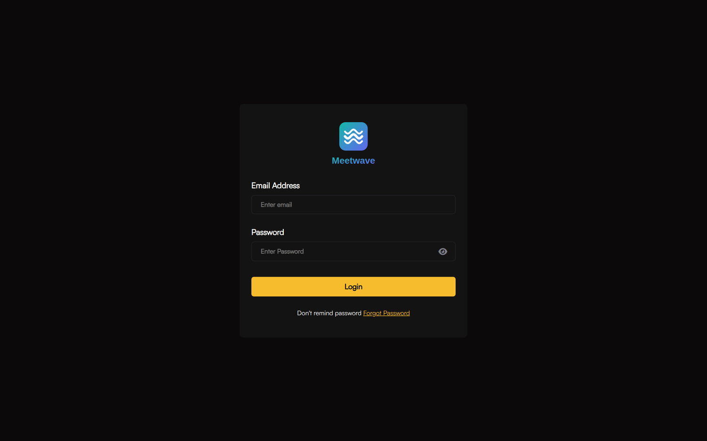
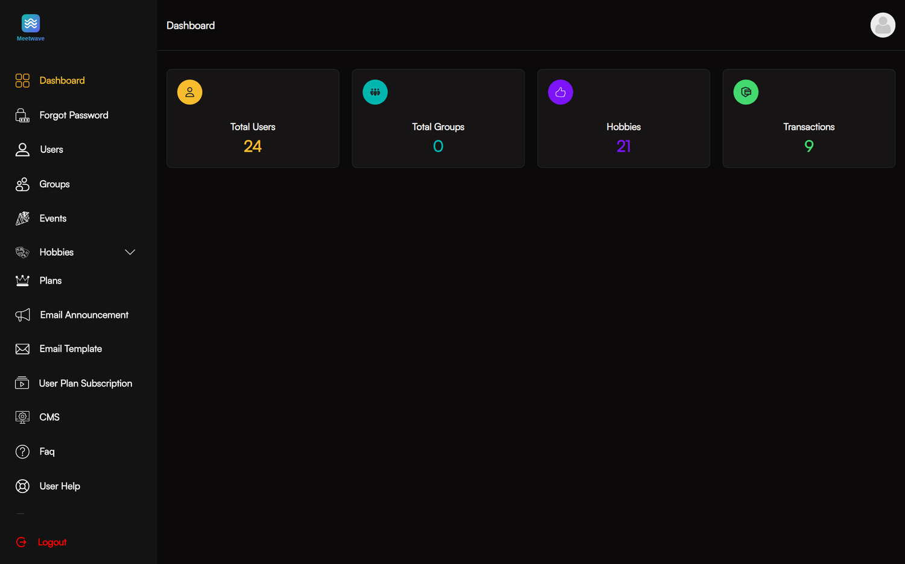
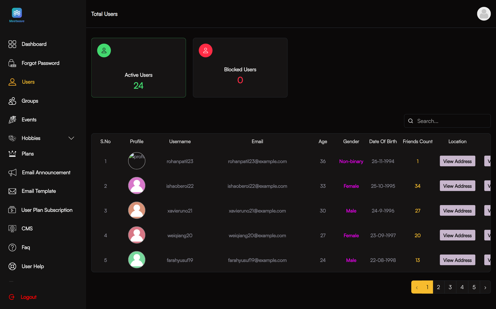
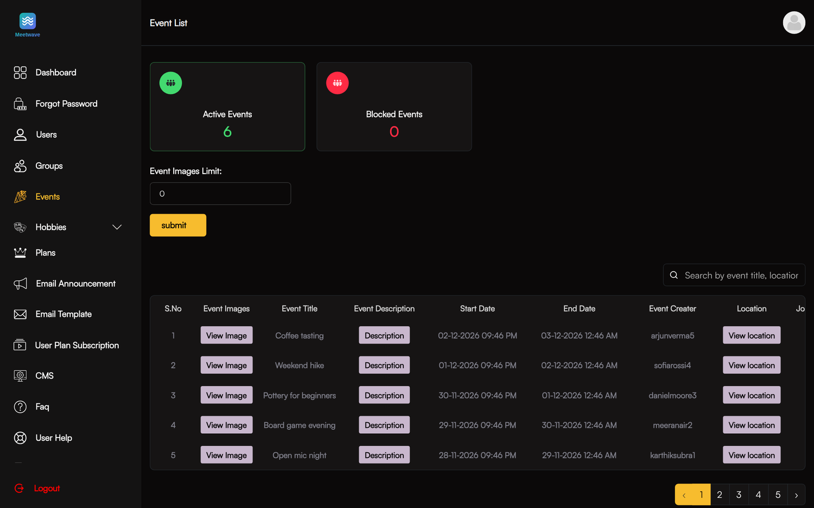
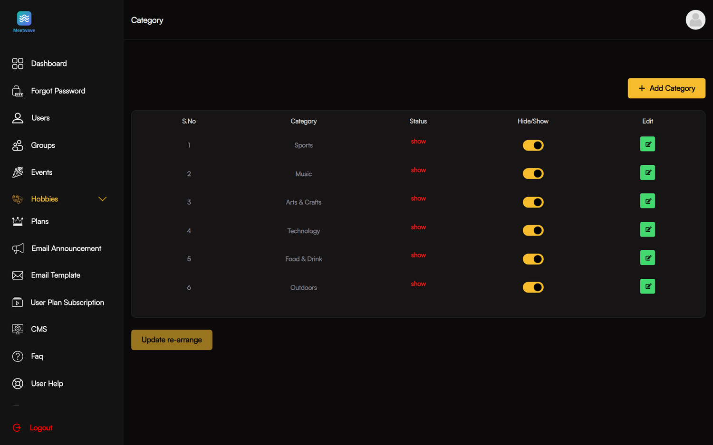
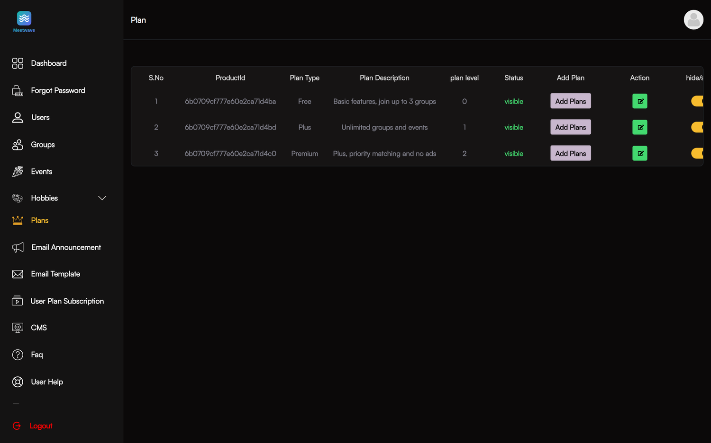
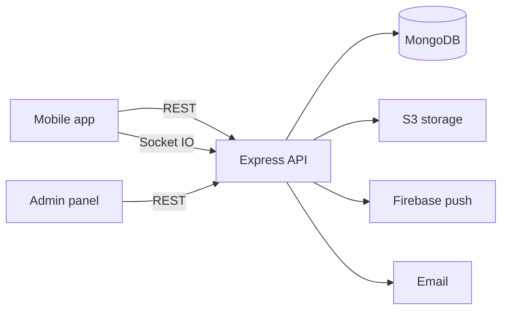

# Meetwave

A social app for meeting people through shared hobbies. People set up a profile, pick the hobbies they care about, then find others nearby, join groups, go to events and chat. It has a React Native mobile app, a Node and MongoDB backend and a React admin panel.

I worked on this as part of a team. This repo is a cleaned copy: the name is changed, and the keys, env files, Firebase files and uploaded user photos are not included.

## What is in it

- `frontend/` is the mobile app (React Native 0.82, Redux Toolkit, React Navigation, Socket.IO client)
- `backend/` is the API (Node, Express, MongoDB with Mongoose, Socket.IO)
- `adminpanel/` is the admin web app (React 18, Redux, React Bootstrap, ApexCharts)

## Mobile app

- Sign up with email and an OTP, set a profile, bio and photos
- Pick hobbies from categories and sub-categories set by the admin
- Find people and groups by hobby, distance and filters, with a map view
- Create and join events, with reminders and a wish list
- One-to-one and group chat with images and voice notes, delivered live over Socket.IO
- Follow requests, blocking, reporting and privacy switches (hide profile, hide hobbies, hide events)
- Free and paid plans through in-app purchases (RevenueCat)
- Push notifications through Firebase
- 12 interface languages

## Admin panel

Everything the app reads from is managed here: users (block and unblock), groups, events, categories, sub-categories and hobbies, subscription plans, user subscriptions, email templates and announcements, CMS pages, FAQs, help requests, feedback and reports.

| | |
|---|---|
|  |  |
|  |  |
|  |  |

Screenshots were taken against a local backend with made-up sample data.

## Backend

REST routes are grouped as `/v1/user`, `/v1/admin`, `/v1/chat`, `/v1/event` and `/v1/cms`. Request and response bodies are AES-encrypted JSON. Passwords are hashed with bcrypt and API calls are protected with JWT. A cron job handles scheduled work, images are processed with sharp, push goes out through firebase-admin and files go to S3.



## Running it

You need Node, MongoDB, and your own Firebase project.

1. Backend: copy `backend/env/.env.example` to `backend/env/.env.local`, fill it in, and put your Firebase service account file at `backend/firebase-credentials.json`. Then:
   ```
   cd backend
   npm install
   NODE_ENV=local node babel_hook.js
   ```
2. Admin panel: copy `adminpanel/.env.example` to `adminpanel/.env`. Use the same `SECRET_KEY` as the backend for `REACT_APP_SECRET_KEY`. Then `npm install` and `npm start`.
3. Mobile app: copy `frontend/.env.example` to `frontend/.env` (`ENKEY` must match the backend `SECRET_KEY`), add your own `google-services.json` for Android, then `npm install` and `npx react-native run-android`.

The first admin has to be added to the `admin` collection by hand with a bcrypt-hashed password.

## Notes

- The apps encrypt request bodies with a shared key, so the key in all three env files has to be the same.
- Several screens carry commented-out older code and there are very few tests.
- Google Maps keys are left blank. Add your own in the admin `.env`, `AndroidManifest.xml` and the iOS app delegate.
